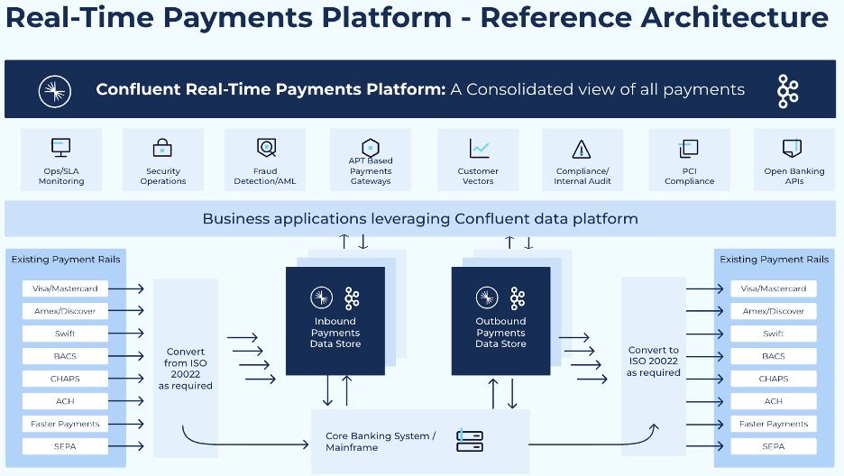

# Real-Time Payment Architecture & Orchestration
A standards-aligned, modular, ISO 20022–native framework for building modern instant payment systems.

<p align="center">
  
  
  
  
  
</p>

## 🔷 Overview
This repository provides a reference architecture and implementation framework for Real-Time Payments (RTP), FedNow®, SEPA Instant, UPI, and ISO 20022-based real-time rails.

It demonstrates how a modern payment system can be structured to support:
- End-to-end orchestration of real-time credit transfers
- ISO 20022-native data models (pacs.008, pacs.009, pacs.002, pain.001)
- Pluggable validation, enrichment, routing, and fraud evaluation
- Event-driven processing (Kafka-ready pipeline)
- Resilience (circuit breaker, DLQ, retries)
- Observability (metrics, structured logs, correlation IDs)
- Extensible microservices-style payment components

This codebase is designed for:
- RTP developers & payments engineers
- Banking architects modernizing legacy payment hubs
- FinTech startups implementing instant rails
- Researchers & students studying ISO 20022 and real-time systems

## 🎯 Core Objectives
This framework demonstrates:

### 1. A complete real-time payment orchestration pipeline
Including:
- Input validation  
- ISO 20022 transformation  
- Fraud/risk evaluation  
- Routing & workflow selection  
- Posting to ledger/core  
- Real-time acknowledgments  

### 2. Alignment with global payment standards
- ISO 20022 schema modeling  
- TCH RTP® conceptual flows  
- FedNow® usage guidelines  
- SEPA Instant processing  
- UPI-style routing & real-time decisioning  

### 3. A real-world architecture foundation
Reflecting:
- Microservices patterns  
- Event-driven design  
- Clean extensibility  
- Enterprise-grade reliability  

## 🖼 Architecture Diagrams


## 📂 Project Structure
```
src/
└─ realtimepaymentarchitectureorchestration/
     ├─ app/
     ├─ orchestration/
     ├─ iso20022/
     ├─ validation/
     ├─ routing/
     ├─ fraud/
     ├─ config/
     ├─ channel/
     ├─ repository/
     ├─ resilience/
     └─ observability/
docs/
diagrams/
```

## 🚀 Getting Started

### Requirements
- Java 17+
- Maven or Gradle

### Build
```
mvn clean install
```

### Run Demo
```
mvn exec:java -Dexec.mainClass="realtimepaymentarchitectureorchestration.app.RealTimePaymentApplication"
```

### Run Tests
```
mvn test
```

## 🧪 Example Usage
```java
PaymentOrchestrator orchestrator = new PaymentOrchestrator();
PaymentChannelAdapter channel = new RestPaymentChannelAdapter(orchestrator);

Map<String, Object> payment = Map.of(
    "debtorAccount", "12345",
    "creditorAccount", "67890",
    "amount", "250.00",
    "currency", "USD"
);

channel.submitPayment(payment);
```

## 🧭 Roadmap
- AI-driven fraud scoring  
- Adaptive routing (cost/performance-based)  
- Persistent ledger store (PostgreSQL/Mongo)  
- gRPC low-latency adapter  
- Full ISO 20022 XML/JSON marshalling  

## 📘 References
See **docs/References.md** for a complete list of RTP, ISO 20022, FedNow®, SEPA Instant, UPI, fraud, and architecture references.

## 👤 Author
**Rahul Autade**  
Payments Modernization & Implementation Leader | RTP | ISO 20022 | Event-Driven Systems  
Portfolio: https://rahulautade2288.github.io/

A personal reference project for learning and discussing real-time payment architecture.
