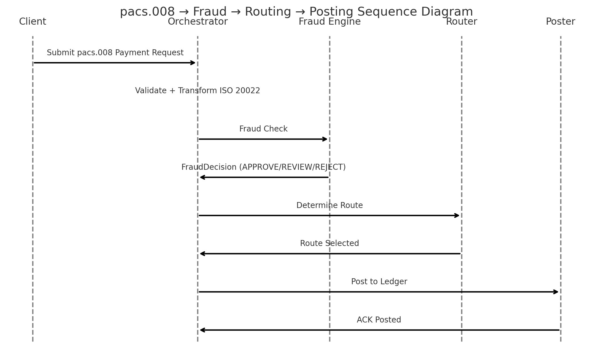

# Real-Time Payment Architecture & Orchestration

A Java reference implementation of how a bank can process an instant payment from start to finish: validate it, enrich it, map it to ISO 20022, screen it for fraud, route it, post it to a ledger and notify both parties. Each step is a small, readable component, so you can follow one payment through the whole pipeline.


## What it covers

- **Orchestration pipeline**: a payment moves through `VALIDATE`, `ENRICH`, `TRANSFORM_TO_ISO20022`, `FRAUD_CHECK`, `ROUTE`, `POST` and `NOTIFY`, with a full audit trail at every step.
- **ISO 20022 domain model**: credit transfer, parties, accounts, agents, amounts, settlement and remittance information, plus a message factory and an XML serializer.
- **Validation**: amount, account status, cut-off time, duplicate and sanctions checks behind a common `ValidationRule` interface.
- **Fraud and risk**: a pluggable fraud check returning approve, review or reject.
- **Routing**: currency, scheme and bank routers with a fallback strategy (for example USD to an internal real-time rail, EUR to SEPA Instant).
- **Resilience and observability**: circuit breaker, dead-letter queue, retry policy, saga coordination with compensation, correlation IDs, metrics and structured logging.
- **RTP rail flows** (`rtp/`): sample flows for an RTP participant covering inbound and outbound messages, limits, liquidity, recalls and returns, request for payment and settlement.

## Run the demo

Requires Java 17 or later. No external libraries are needed for the main code.

```bash
git clone https://github.com/RahulAutade2288/real-time-payment-architecture-orchestration.git
cd real-time-payment-architecture-orchestration

find src -name "*.java" -not -path "*/test/*" > sources.txt
javac -d out @sources.txt
java -cp out realtimepaymentarchitectureorchestration.app.RealTimePaymentApplication
```

Type `demo` to send a sample payment through the pipeline, `info` to see the configuration, and `quit` to exit. The demo prints every step:

```text
Demo payment result: SUCCESS
  - Validation succeeded
  - Enrichment completed
  - Transformed into ISO 20022 inspired structure
  - Fraud check result: APPROVE
  - Routing decided: INTERNAL_RT
  - Posted to simulated ledger with id=LEDGER-...
  - Notifications sent to debtor and creditor (simulated)
```

JUnit 5 tests for the amount validator, router and orchestrator are in `src/test/java`.

## Use it from code

```java
PaymentOrchestrator orchestrator = new PaymentOrchestrator();
PaymentChannelAdapter channel = new RestPaymentChannelAdapter(orchestrator);

channel.submitPayment(Map.of(
    "debtorAccount", "12345",
    "creditorAccount", "67890",
    "amount", "250.00",
    "currency", "USD"
));
```

## Project layout

```text
src/realtimepaymentarchitectureorchestration/
├── app/            Entry point, configuration, bootstrapper
├── channel/        Inbound channel adapters
├── config/         Flow and pipeline definitions
├── orchestration/  Pipeline, lifecycle, saga, retry, workflow registry
├── iso20022/       ISO 20022 domain model and serialization
├── validation/     Validation rules
├── fraud/          Fraud check and decisions
├── routing/        Currency, scheme and bank routing
├── service/        Ledger, posting, notification, audit, risk services
├── repository/     In-memory payment repository
├── resilience/     Circuit breaker, dead-letter queue
├── observability/  Correlation IDs, metrics, logging
└── rtp/            RTP rail flows
diagrams/           Architecture, sequence and flow diagrams (PNG and PlantUML)
docs/               Architecture notes and references
```

## Diagrams

The `diagrams/` folder includes the end-to-end lifecycle, the pacs.008 to posting sequence, routing decisions, the fraud workflow, Kafka event streaming and the pacs.008 message structure.



## Roadmap

- Persistent ledger store
- Real Kafka producers and consumers
- Full ISO 20022 XML and JSON marshalling with schema validation
- Scheme-specific profiles for RTP, FedNow and SEPA Instant
- AI-assisted fraud scoring and cost-based routing

## References

Official RTP, FedNow and ISO 20022 sources are listed in [docs/References.md](docs/References.md).

## Disclaimer

This is a learning and reference project. It is not production payment software and is not affiliated with any payment network.

## Author

**Rahul Autade**, Payments Modernization & Implementation Leader
[rahulautade2288.github.io](https://rahulautade2288.github.io/) · [LinkedIn](https://www.linkedin.com/in/rahul-autade/)
